<div align="center">

<!-- Animated GIF rather than SVG on purpose: GitHub proxies SVGs through camo and strips
     scripts/animation, while a GIF plays everywhere. Editable source: assets/banner.svg,
     generated by scripts/build-banner-gif.py. Static fallback: assets/banner.png -->
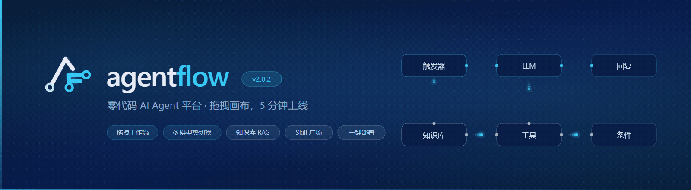

<br>

[](https://github.com/PHclaw/agentflow/stargazers)
[](https://github.com/PHclaw/agentflow/forks)
[](https://github.com/PHclaw/agentflow/issues)
[](LICENSE)
[](https://github.com/PHclaw/agentflow/pulls)

[](.github/workflows/ci.yml)
[](https://python.org)
[](https://fastapi.tiangolo.com)
[](https://react.dev)
[](https://typescriptlang.org)
[](docker-compose.yml)

**Drag-and-drop AI Agent workflows · No code required · Live in 5 minutes**

An open-source, zero-code AI Agent platform: drag-and-drop workflow editor + multi-model hot-swap + knowledge-base RAG + Skill marketplace + one-command deploy.<br>
Runs on SQLite out of the box, so a single machine is enough — and every byte of data stays on your own hardware.

[Live demo](#-live-demo) · [Quick start](#-quick-start) · [Features](#-features) · [Built-in skills](#-built-in-skills) · [Docs](#-docs) · [FAQ](docs/FAQ.md)

<br>

[English](README.en.md) · [中文](README.md)

</div>

---

## 📖 Table of contents

- [Live demo](#-live-demo)　·　[Screenshots](#️-screenshots)
- [Features](#-features)　·　[Built-in skills](#-built-in-skills)
- [Quick start](#-quick-start)　·　[Key configuration](#️-key-configuration)
- [Architecture](#️-architecture)　·　[Project layout](#-project-layout)
- [How it differs from Dify / Coze](#️-how-it-differs-from-dify--coze)
- [Roadmap](#️-roadmap)　·　[Contributing](#-contributing)
- [Disclaimer](#️-disclaimer)　·　[License](#-license)　·　[Support](#-support)

---

## 📽️ Live demo

> Real screen recordings (captured by a headless browser, unedited). Full videos live in `assets/videos/`.

<h3 align="center">① The whole flow, end to end</h3>

Landing page → sign in → pick a template from the marketplace → create an Agent → chat → put a Skill to work. One clip, everything the product can do.

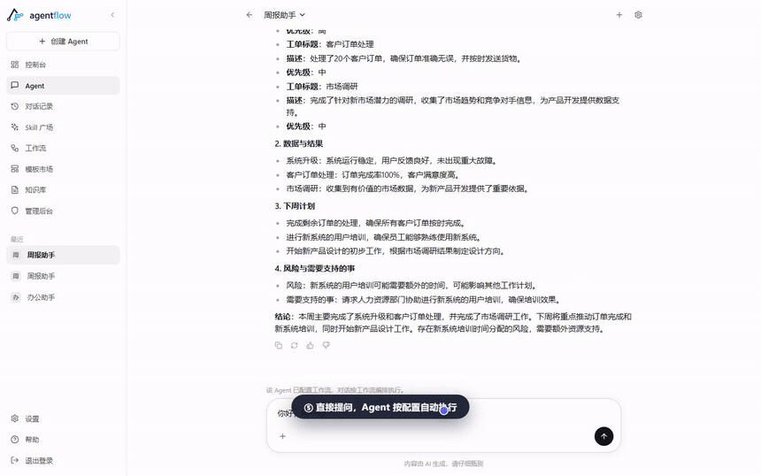

<p align="center"><a href="assets/videos/demo-product-tour.mp4">▶ Full recording</a></p>

<h3 align="center">② One sentence to a PPT — end-to-end delivery</h3>

Describe what you need in the chat box. The Agent reads its own workspace, writes code, runs scripts, and hands the result back as a **downloadable attachment**.

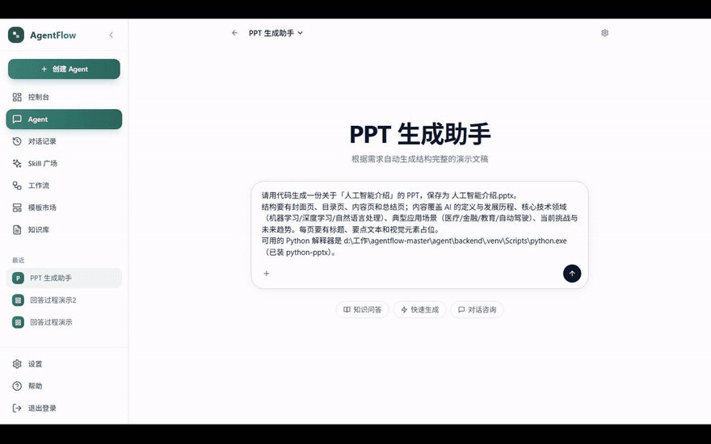

<p align="center">
  <a href="assets/videos/demo-ppt-generation.mp4">▶ Full conversation</a> &nbsp;·&nbsp;
  <a href="assets/videos/demo-ppt-result-preview.mp4">▶ Page-by-page preview</a>
</p>

<h3 align="center">③ Building a workflow by dragging nodes</h3>

Pick nodes from the left panel onto the canvas, edit parameters on the right, save and it takes effect immediately — no code at any point.

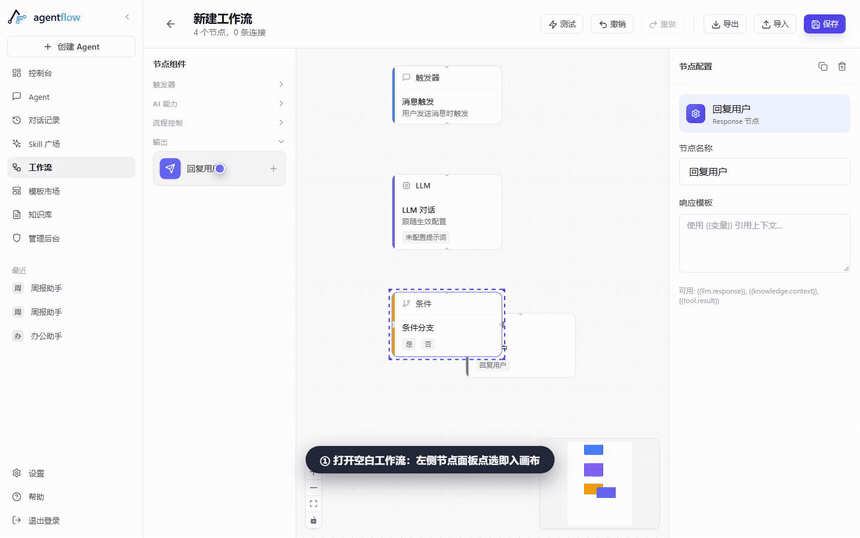

<p align="center">
  <a href="assets/videos/demo-workflow-canvas.mp4">▶ Full recording</a> &nbsp;·&nbsp;
  <a href="assets/videos/demo-workflow-build.mp4">▶ Wiring nodes together</a>
</p>

<h3 align="center">④ Skill marketplace: paste a table, get a chart</h3>

No need to tidy up the format first — messy tables with Chinese units are understood too. The chart shows up in the conversation seconds later, with the raw data and the script alongside.


<p align="center"><a href="assets/videos/demo-skill-plaza.mp4">▶ Full recording</a></p>

<h3 align="center">⑤ Knowledge base: upload and semantic search</h3>

Upload a document → automatic chunking and indexing → recall by relevance when you ask a question. Matched snippets are highlighted right in the UI.

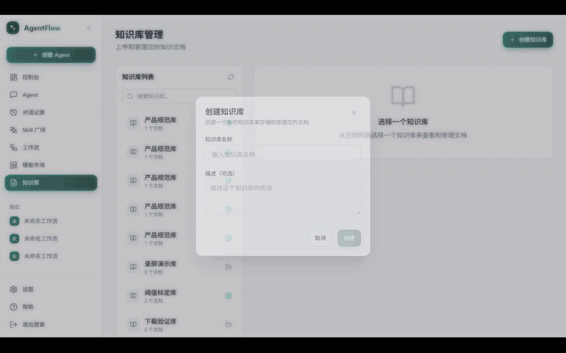

<p align="center"><a href="assets/videos/demo-knowledge-rag.mp4">▶ Full recording</a></p>

<h3 align="center">⑥ Tool calls inside a conversation</h3>

While the Agent runs, a live "calling tool" line appears; only the current one stays on screen, and it hides itself as soon as the reply is done.

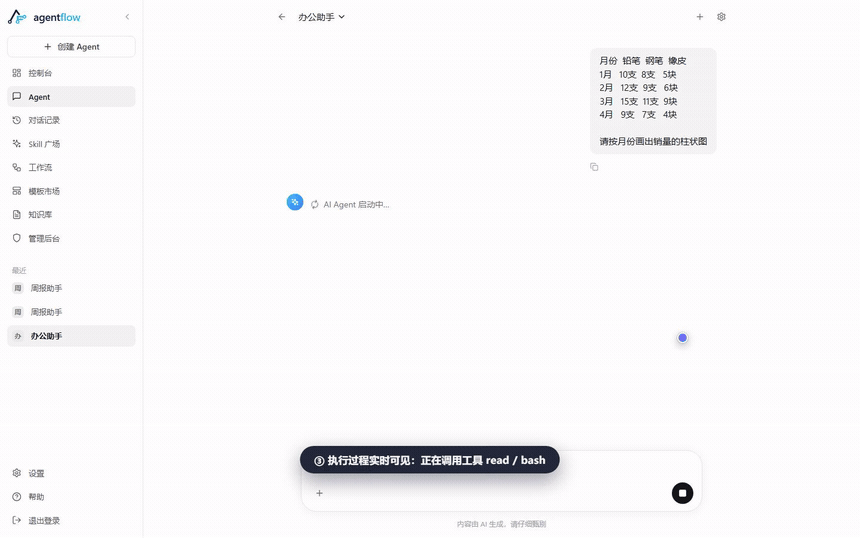

<p align="center"><a href="assets/videos/demo-chat-tool-calls.mp4">▶ Full recording</a></p>

---

## 🖼️ Screenshots

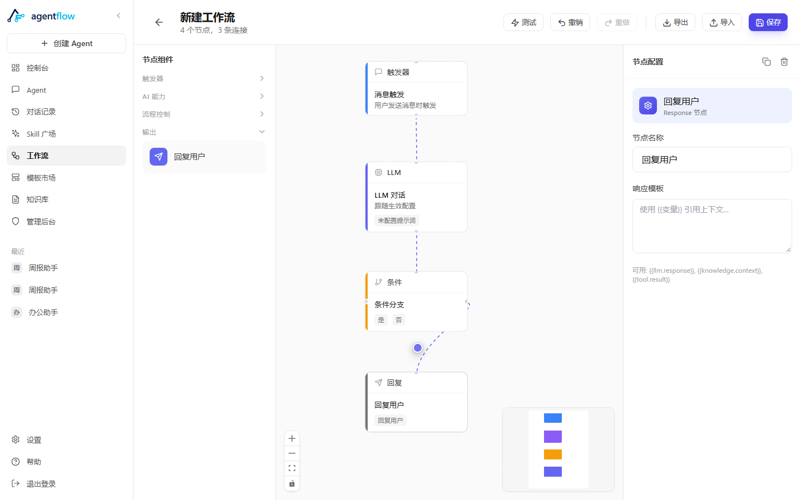

**Workflow editor** — three-column layout of node panel / drag-and-drop canvas / node configuration, node and connection counts in the top bar, with test, undo/redo, import and export.

<table>
<tr>
<td width="50%">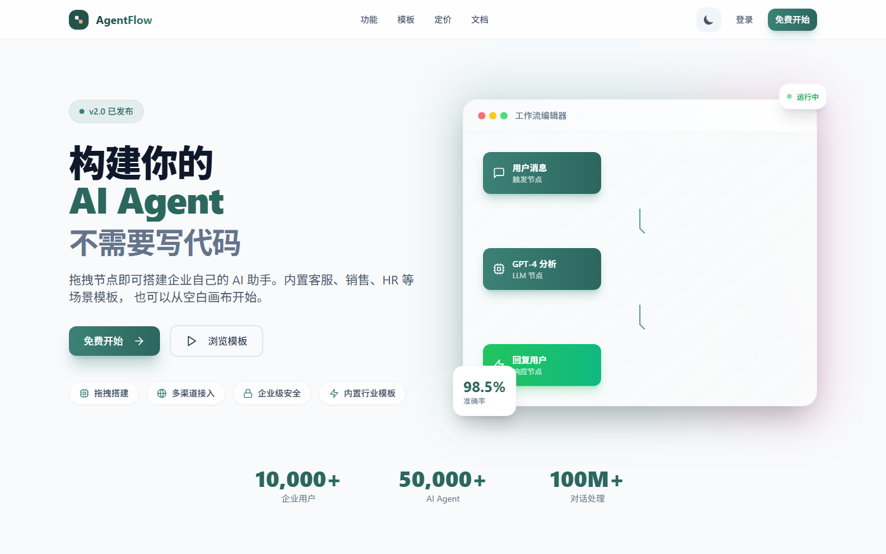<br><sub><b>Landing page</b> — the no-code value proposition</sub></td>
<td width="50%">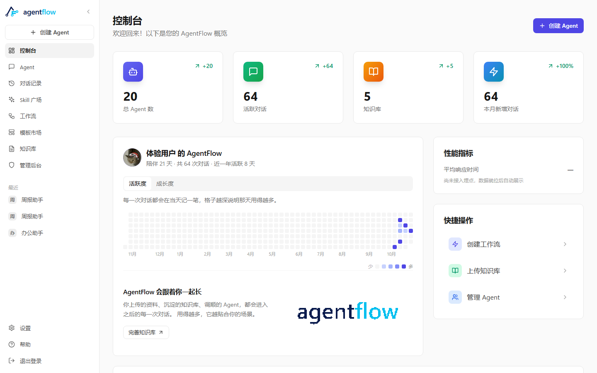<br><sub><b>Dashboard</b> — agents, active conversations, model usage</sub></td>
</tr>
<tr>
<td width="50%">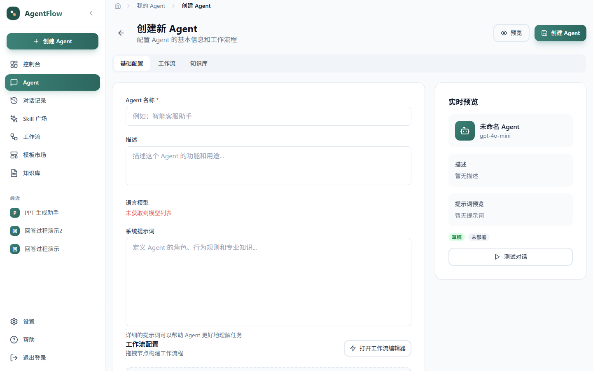<br><sub><b>Agent setup</b> — model, prompt, workflow, skills</sub></td>
<td width="50%">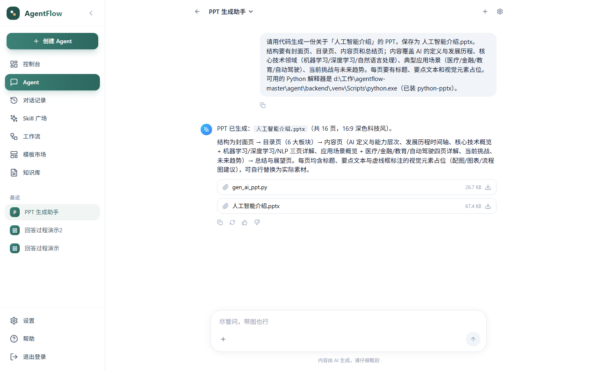<br><sub><b>Chat</b> — streaming replies with inline artifact preview</sub></td>
</tr>
<tr>
<td width="50%">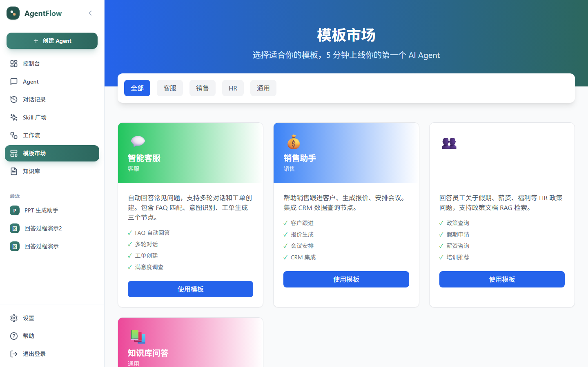<br><sub><b>Template marketplace</b> — browse by category, one click to apply</sub></td>
<td width="50%">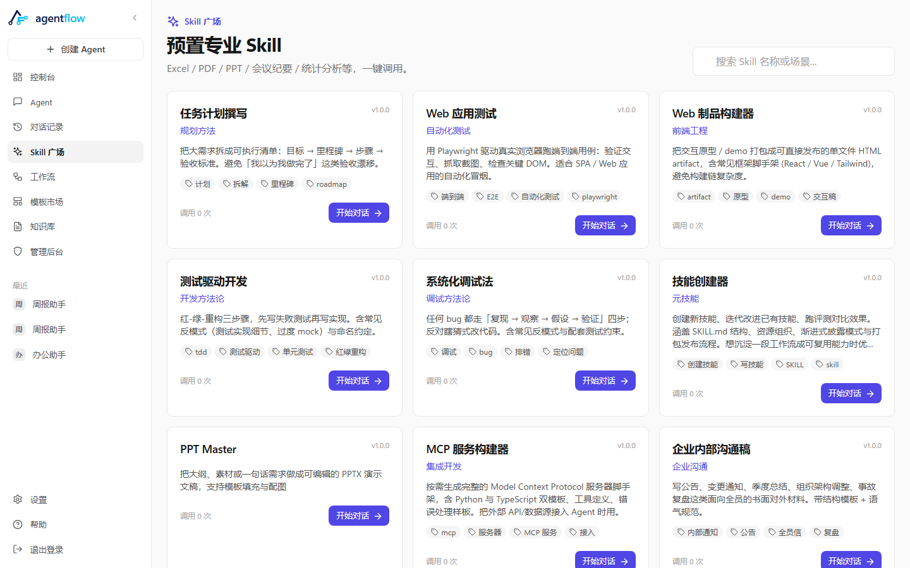<br><sub><b>Skill plaza</b> — 9 built-in skills, ready to use</sub></td>
</tr>
<tr>
<td width="50%">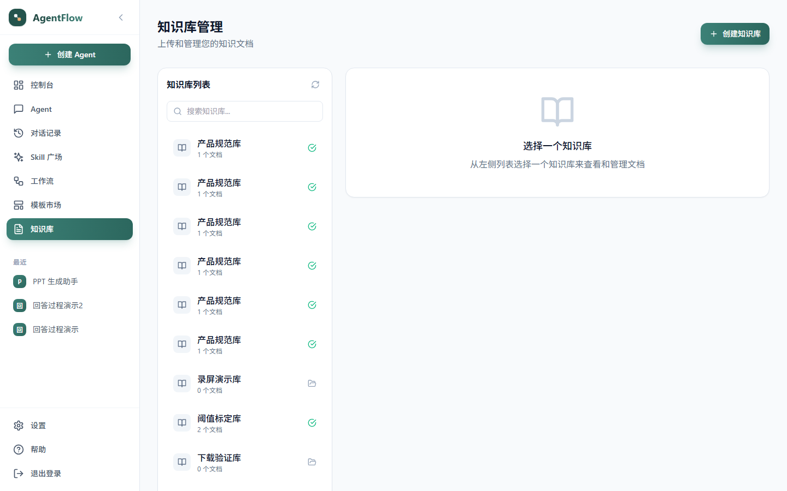<br><sub><b>Knowledge base</b> — upload, chunk, semantic search</sub></td>
<td width="50%">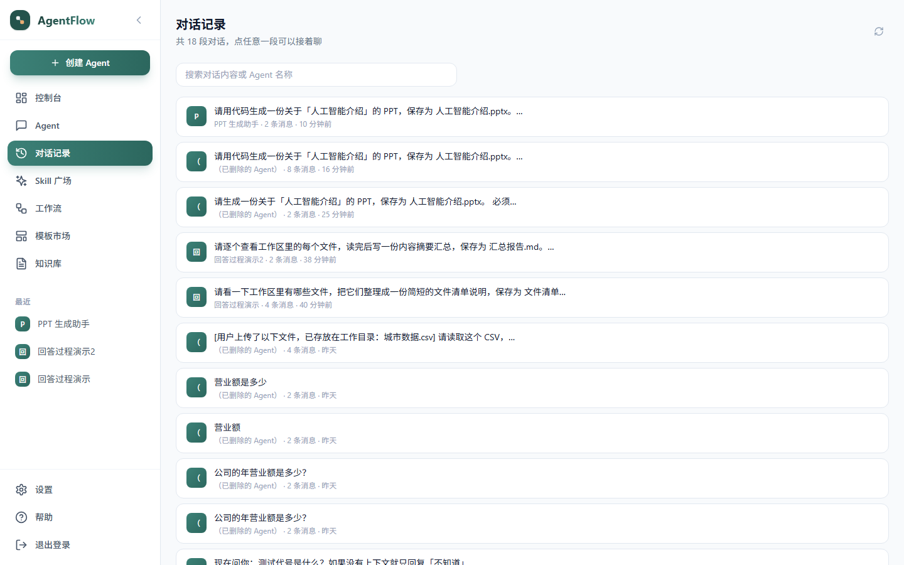<br><sub><b>Conversations</b> — pick any past session and keep talking</sub></td>
</tr>
</table>

---

## ✨ Features

- **🎨 Drag-and-drop workflow editor** — ReactFlow canvas with six node types (Trigger / LLM / Knowledge / Tool / Condition / Response) to combine freely; edits take effect on save
- **🤖 Multi-model hot-swap** — just fill in the endpoint and model name under Settings → Model Config. Works with any **OpenAI-compatible** endpoint (including local Ollama), **no restart needed**
- **📚 Knowledge-base RAG** — documents are chunked and indexed on upload, vector recall returns results with relevance scores; the embedding model is configured **separately** from the chat model
- **🧩 Skill marketplace** — 9 built-in skills (Excel / PPT / PDF / academic search / meeting notes / statistics and more), admins can add or remove them from the console
- **📎 Artifact delivery** — files generated by an Agent come back as downloadable attachments, and **image artifacts render inline in the conversation** instead of forcing a download first
- **🧰 Template marketplace** — customer service / sales / HR / finance scenarios; one click turns a template into a working Agent
- **👤 User system** — JWT auth, email-code signup, plan quotas, admin allowlist, fully self-hosted data

**Who it's for**: companies that want an AI customer-service or sales assistant but have no dev team; product managers who need to validate an Agent scenario fast; developers who want to orchestrate LLM workflows with low code.

---

## 🚀 Quick start

### Requirements

| Dependency | Version | Notes |
|:--|:--|:--|
| Python | 3.11+ | CI baseline; official images use 3.13 |
| Node.js | 18+ | CI baseline; official images use 20 |
| Docker | 20+ | Recommended — one command brings everything up |

> **Neither PostgreSQL nor Redis is required.** SQLite is the default, and when Redis is missing verification codes fall back to process memory — plenty for a single-machine deployment.

### Option 1: Docker (recommended)

```bash
git clone https://github.com/PHclaw/agentflow.git
cd agentflow
cp .env.example .env      # at minimum, set JWT_SECRET_KEY
docker compose up -d --build
docker compose logs -f backend
```

Open http://localhost:3000 and you're in. The default stack is just two containers (backend + frontend/nginx), data lands in `./data/agentflow.db`, and `docker compose down` won't lose it.

If you need PostgreSQL + pgvector:

```bash
docker compose --profile postgres up -d
```

### Option 2: local development

```bash
# backend
cd backend && python -m venv venv
.\venv\Scripts\Activate.ps1          # macOS / Linux: source venv/bin/activate
pip install -r requirements.txt
uvicorn app.main:app --reload --port 8001

# frontend (in another terminal)
cd frontend && npm install && npm run dev
```

The frontend dev server runs on http://localhost:5173 , the backend on http://localhost:8001 .

### Option 3: SQLite single-machine lite mode

Just want the backend running, without installing PostgreSQL and Redis:

```powershell
.\scripts\dev-backend.ps1
```

> For environment variables, model configuration and other details, see the **[configuration guide](docs/CONFIGURATION.md)**.

---

## ⚙️ Key configuration

The full list lives in [`.env.example`](.env.example) (every entry is commented) and the **[configuration guide](docs/CONFIGURATION.md)**. The ones you'll touch most:

| Variable | Required | Notes |
|:--|:--:|:--|
| `JWT_SECRET_KEY` | ✅ | Falls back to a built-in plaintext secret when empty, which means anyone can forge a token. `openssl rand -hex 32` |
| `DATABASE_URL` | — | Empty = SQLite; for PostgreSQL use `postgresql+asyncpg://…` |
| `REDIS_URL` | — | Empty = verification codes in process memory; only needed for multi-instance deploys |
| `EMBEDDING_BASE_URL` | Recommended for Docker | Embedding model for the knowledge base. **The official image does not ship sentence-transformers**, so leaving it empty falls back to local inference and fails |
| `ADMIN_EMAILS` | — | Admin email allowlist; logging in grants console access (grant-only, never revoked) |
| `REQUIRE_EMAIL_CODE` | — | Keep `true` in production; set `false` for internal demos |
| `MAIL_ENABLED` | — | When `false` no mail is sent and the code is printed to the backend log |
| `FREE_AGENTS` / `TEAM_AGENTS` etc. | — | Plan quotas, **defined in exactly one place**, shared by copy and enforcement |

**Three easy traps** (all spelled out in `.env.example`):

1. **Don't leave `DATABASE_URL` as an empty string.** An empty value is treated as a real connection string and the backend won't start — if you don't need to change it, comment the whole line out.
2. **Always set `EMBEDDING_BASE_URL` for Docker deployments.** The image doesn't include `sentence-transformers` (about 2GB extra), so knowledge-base search is unavailable when it's empty.
3. **Changing plan quotas requires a re-login to take effect.** Quotas are defined once in `.env` to avoid "advertise 20, enforce 5".

---

## 🏗️ Architecture

```
   React 18 + ReactFlow  ──►  FastAPI  ──►  SQLite (default)
        frontend :5173 / :3000      backend :8001      └ switchable to PostgreSQL + pgvector
                                                          └ Redis (optional, verification codes)
```

| Layer | Tech |
|:--|:--|
| Frontend | React 18 · TypeScript 5.3 · Vite 5 · ReactFlow 11 · Tailwind CSS 3 · Zustand 4 · react-router 6 |
| Backend | Python 3.11+ · FastAPI · SQLAlchemy 2.0 (async) · Alembic · pydantic-settings |
| Storage | SQLite (default, `aiosqlite`) · PostgreSQL + pgvector (optional) · Redis (optional) |
| Models | Any OpenAI-compatible endpoint: OpenAI · Anthropic · DeepSeek · Qwen · Ollama … |
| Retrieval | Vector embeddings configured independently, decoupled from the chat model |
| Deploy | Docker Compose (FastAPI + nginx) · local venv / npm |
| CI | GitHub Actions: ruff + pytest / tsc + vite build |

The full picture — system architecture, workflow node types, request flow — is in the **[architecture guide](docs/ARCHITECTURE.md)**.

---

## 📁 Project layout

```
agentflow/
├── backend/            # FastAPI application
│   ├── app/
│   │   ├── api/        # REST routes: auth / users / agents / templates / knowledge / chat / skills …
│   │   ├── core/       # config, security, database
│   │   ├── models/     # SQLAlchemy models
│   │   └── services/   # workflow engine, skill execution, model gateway
│   └── tests/
├── frontend/           # React + Vite application
│   └── src/
│       ├── pages/      # landing / dashboard / agent / workflow / chat / skills / knowledge / templates
│       ├── components/ # UI kit, layout, workflow nodes
│       ├── stores/     # Zustand
│       └── services/   # API client
├── skills/             # skill definitions (one directory each, with SKILL.md and scripts)
├── scripts/            # dev scripts + UI recording/diagnostics (ui-record.mjs generates demo assets)
├── docs/               # documentation
├── assets/             # banner / screenshots / GIFs / videos used by the README
├── config/             # static config for model validation
├── docker-compose.yml
└── .env.example
```

---

## 🧩 Built-in skills

Ready to use in the Skill plaza; admins can add or remove them from the console (just edit the `skills/` directory):

| Skill | What it does |
|:--|:--|
| **Excel Assistant** | Paste a hand-written table → bar/pie charts, or aggregate and export Excel |
| **PPT Assistant** | Generates a deck after confirming purpose and slide count |
| **PPT Master** | Template-driven layout generation (built-in layouts, charts, icon library) |
| **PDF Assistant** | Upload a PDF → extract table of contents, key points, tables |
| **Academic Search** | Search papers by topic, with year, authors and core contributions |
| **Paper Notes** | Turn a paper into problem / method / results / limitations notes |
| **Meeting Notes** | Raw meeting transcript → conclusions + to-dos + owners + deadlines |
| **Clinical Case Report** | Chief complaint and findings → structured teaching case |
| **Statistics Assistant** | Hypothesis testing, confidence intervals, sample size estimation, with decision advice |

A skill is just a directory containing a `SKILL.md`. Add a folder in the same format to extend it with your own.

---

## ⚖️ How it differs from Dify / Coze

|  | AgentFlow | Dify | Coze |
|:--|:--:|:--:|:--:|
| Deployment | Self-hosted first, **SQLite single-machine by default** | Self-hosted / cloud | Cloud only |
| Data ownership | All in your own database | Yours when self-hosted | On the platform side |
| License | **GPL-2.0** | Open source (with additional terms) | Closed source |
| Multi-model hot-swap | Change it in the UI, **no restart** | Edit config | Platform-bound |
| Skill extension | Add a directory with `SKILL.md` | Plugin marketplace | Plugin marketplace |
| Artifact attachments | ✅ file download + **inline image preview** | Partial | Partial |
| Browser automation | Supported (Browser-Use) | — | — |

The full comparison lives in **[How it differs from Dify / Coze](docs/COMPARISON.md)**.

---

## 🗺️ Roadmap

- [x] Drag-and-drop workflow editor (six node types)
- [x] Multi-model hot-swap + any OpenAI-compatible endpoint
- [x] Knowledge-base RAG (embedding model configured independently)
- [x] Skill plaza and template marketplace
- [x] Artifact delivery + inline image preview
- [x] One-command Docker Compose deploy (SQLite by default)
- [ ] End-to-end pgvector path verification
- [ ] Async task queue (the current compose has no worker container; `celery_app.py` is unreferenced)
- [ ] More built-in skills and templates

---

## 📚 Docs

| Document | Contents |
|:--|:--|
| [Configuration guide](docs/CONFIGURATION.md) | Environment variables · model hot-swap · SQLite lite mode |
| [Architecture guide](docs/ARCHITECTURE.md) | System architecture · workflow node types · project layout |
| [Deployment guide](docs/DEPLOYMENT.md) | Docker · Nginx reverse proxy · database backup |
| [API reference](docs/API.md) | REST endpoints · auth · error handling |
| [Development guide](docs/DEVELOPMENT.md) | Tests · database migrations · UI diagnostic scripts |
| [FAQ](docs/FAQ.md) | Models · RAG · self-hosting · billing |
| [Changelog](docs/CHANGELOG.md) | Version history and roadmap |

> These documents are written in Chinese.

Once the server is up, the live API docs are at http://localhost:8001/docs (Swagger) · http://localhost:8001/redoc

---

## 🤝 Contributing

Issue → Fork → Branch → Develop → Test → PR → Review → Merge

- Run the two CI steps locally before pushing: `cd backend && ruff check app/ && python -m pytest tests/ -v` and `cd frontend && npx tsc --noEmit && npm run build`
- New skills: add a folder with a `SKILL.md` under `skills/`, following the existing directory structure

---

## ⚠️ Disclaimer

> **Important: this project is for learning, academic research and educational purposes only**

**Compliance statement:**

- All code, tools and functionality in this project are for learning, academic research and educational purposes only
- Any commercial or profit-making use of this project is strictly prohibited
- Any use of this project that is illegal, non-compliant, or infringes on the rights of others is strictly prohibited

**Crawler disclaimer:**

- The crawler functionality in this project is for technical learning and research only
- Users must comply with the robots.txt protocol and terms of use of the target websites
- Users must comply with applicable laws and regulations, and must not crawl maliciously or abuse data
- Any legal consequences arising from use of the crawler functionality are borne solely by the user

**Data usage disclaimer:**

- The data analysis features in this project are for academic research only
- Using analysis results for commercial decisions or profit is strictly prohibited
- Users should ensure the legality and compliance of the data being analyzed

**Technical disclaimer:**

- This project is provided "as is", without any express or implied warranty
- The authors accept no liability for any direct or indirect loss caused by use of this project
- Users should assess the suitability and risk of the project themselves

**Limitation of liability:**

- Users should fully understand applicable laws and regulations before using this project
- Users should ensure their use complies with local laws and regulations
- Any consequence arising from use of this project in violation of laws and regulations is borne solely by the user

Please read and understand the disclaimer above carefully before using this project. Use of this project constitutes acceptance of all terms stated here.

---

## 📄 License

Released under the **GPL-2.0** license. See the [LICENSE](LICENSE) file for details.

---

## 🎉 Support

### Getting help

| Channel | Where |
|:--|:--|
| FAQ | #700 |
| Project home | [GitHub repository](https://github.com/PHclaw/agentflow) |
| Bug reports | [Issues](https://github.com/PHclaw/agentflow/issues) |
| Feature requests | [Discussions](https://github.com/PHclaw/agentflow/discussions) |

### Contact

📧 Email: 2730545346@qq.com

### Business inquiries

- Enterprise custom development
- Big data services
- Academic collaboration
- Technical training

---

<div align="center">

**Find it useful? Leave a ⭐**

[⭐ Star](https://github.com/PHclaw/agentflow) · [🍴 Fork](https://github.com/PHclaw/agentflow/fork) · [🐛 Issues](https://github.com/PHclaw/agentflow/issues)

</div>
