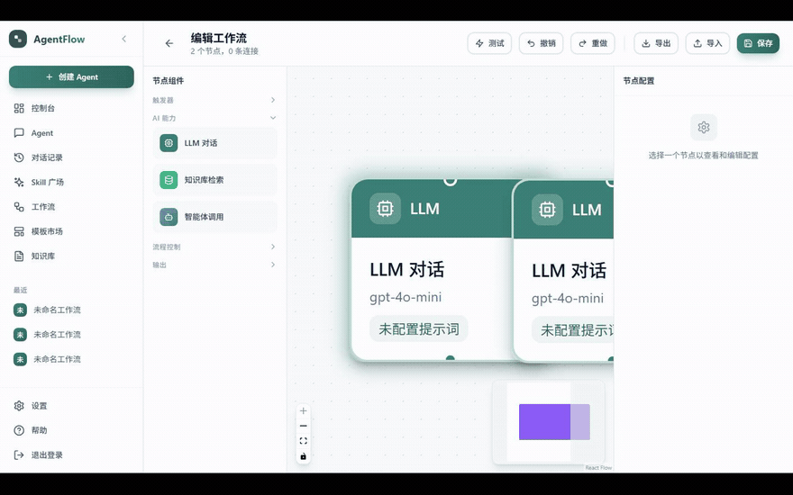

<div align="center">

<!-- 这里用 GIF 而不是 SVG：GitHub 会把 SVG 交给 camo 代理做净化，脚本一定被剥掉、SMIL/CSS 动画也不保证执行，GIF 则无条件播放。可编辑源文件是同目录的 assets/banner.svg，静态回退是 assets/banner.png -->


<br>

[](https://github.com/PHclaw/agentflow/stargazers)
[](https://github.com/PHclaw/agentflow/forks)
[](https://github.com/PHclaw/agentflow/issues)
[](LICENSE)
[](https://github.com/PHclaw/agentflow/pulls)

[](https://python.org)
[](https://fastapi.tiangolo.com)
[](https://react.dev)
[](https://typescriptlang.org)
[](docker-compose.yml)

**拖拽式构建 AI Agent 工作流 · 无需一行代码 · 5 分钟上线**

开源零代码 AI Agent 平台：拖拽式工作流编辑器 + 多模型支持 + 知识库 RAG + 一键部署。

[功能演示](#-功能演示) · [快速开始](#-快速开始) · [核心特性](#-核心特性) · [文档](#-文档) · [常见问题](docs/FAQ.md)

[English](README.en.md) · [中文](README.md)

</div>

---

## 📽️ 功能演示

> 全部是真实录屏（headless 浏览器自动采集，未剪辑）。完整视频在 `assets/videos/`。

<h3 align="center">① 一句话生成 PPT —— 端到端交付</h3>

在对话框里描述需求，Agent 自己读工作区、写代码、跑脚本，最后把生成的文件作为**可下载附件**交回来。


<p align="center">
  <a href="assets/videos/demo-ppt-generation.mp4">▶ 完整对话过程（51s）</a> &nbsp;·&nbsp;
  <a href="assets/videos/demo-ppt-result-preview.mp4">▶ 生成结果逐页预览（20s）</a>
</p>

<h3 align="center">② 拖拽搭建工作流</h3>

左侧节点面板点选即入画布，右侧实时编辑参数，保存后立即生效——全程不写代码。



<p align="center"><a href="assets/videos/demo-workflow-build.mp4">▶ 完整录屏（12s）</a></p>

<h3 align="center">③ 对话中的工具调用</h3>

Agent 执行时实时显示「正在调用工具」，同屏只保留当前这一条，回复生成完毕自动隐藏。


<p align="center"><a href="assets/videos/demo-chat-tool-calls.mp4">▶ 完整录屏（8s）</a></p>

<h3 align="center">④ 知识库上传与语义检索</h3>

上传文档 → 自动分块入库 → 提问时按相关度召回，命中片段在界面直接标出。


<p align="center"><a href="assets/videos/demo-knowledge-rag.mp4">▶ 完整录屏（26s）</a></p>

---

## 🖼️ 界面一览


**工作流编辑器** — 节点面板 / 拖拽画布 / 节点配置三栏布局，顶部显示节点与连接数，支持测试、撤销重做、导入导出。

<table>
<tr>
<td width="50%"><br><sub><b>落地页</b> — 无代码搭建的价值主张</sub></td>
<td width="50%"><br><sub><b>Agent 配置</b> — 模型、提示词、知识库、技能</sub></td>
</tr>
<tr>
<td width="50%"><br><sub><b>对话页</b> — 流式回复 + 可下载产物附件</sub></td>
<td width="50%"><br><sub><b>对话记录</b> — 随时回到历史会话继续聊</sub></td>
</tr>
<tr>
<td width="50%"><br><sub><b>Skill 广场</b> — Excel / PDF / PPT 等预置技能</sub></td>
<td width="50%"><br><sub><b>知识库</b> — 上传、分块、语义检索</sub></td>
</tr>
</table>

---

## ✨ 核心特性

- **🎨 拖拽式工作流编辑** — ReactFlow 画布，LLM / 条件分支 / 工具 / 知识库 / 智能体 / 回复节点自由组合
- **🤖 多模型支持** — OpenAI · Claude · DeepSeek · Ollama，界面里填密钥即可，**热切换不用重启**
- **📚 知识库 RAG** — 上传文档自动分块，pgvector 向量检索，结果带相关度
- **🧩 Skill 广场** — Excel / PDF / PPT / 会议纪要 / 统计分析等 8 个预置技能，开箱即用
- **📎 产物交付** — Agent 生成的文件作为可下载附件回传，对话记录支持回访续聊
- **🌐 浏览器自动化** — 内置 Browser-Use 引擎，AI 直接操控浏览器完成任务
- **👤 用户体系** — JWT 认证，数据完全自托管，不经过任何第三方

**适合谁用**：想搭 AI 客服 / 销售助手但没有开发团队的企业；需要快速验证 Agent 场景的产品经理；想用低代码编排 LLM 工作流的开发者。

---

## 🚀 快速开始

### 环境要求

| 依赖 | 版本 |
|:--|:--|
| Python | 3.11+ |
| Node.js | 18+ |
| PostgreSQL | 14+（需 pgvector 扩展） |
| Redis | 7+ |
| Docker（推荐） | 20+ |

### Docker（推荐）

```bash
git clone https://github.com/PHclaw/agentflow.git
cd agentflow
cp .env.example .env      # 必填 JWT_SECRET_KEY 与至少一个模型 API Key
docker compose up --build
```

前端 http://localhost:3000 · 后端 http://localhost:8001

### 本地开发

```bash
# 后端
cd backend && python -m venv venv
.\venv\Scripts\Activate.ps1          # macOS / Linux: source venv/bin/activate
pip install -r requirements.txt
uvicorn app.main:app --reload --port 8001

# 前端（另开一个终端）
cd frontend && npm install && npm run dev
```

只想把后端跑起来、不想装 PostgreSQL 和 Redis？用 SQLite 轻量模式：

```powershell
.\scripts\dev-backend.ps1
```

> 环境变量、模型配置、SQLite 模式等细节见 **[配置说明](docs/CONFIGURATION.md)**。

---

## 🏗️ 技术架构

```
  React 18 + ReactFlow  ──►  FastAPI  ──►  PostgreSQL + pgvector
      前端 :3000              后端 :8001      Redis · Celery Worker
```

| 层 | 技术 |
|:--|:--|
| 前端 | React 18 · TypeScript 5 · Vite 5 · ReactFlow · Tailwind CSS · Zustand |
| 后端 | Python 3.11 · FastAPI · SQLAlchemy 2.0 · Alembic · Celery |
| 存储 | PostgreSQL 14 + pgvector · Redis 7 |
| 模型 | OpenAI · Anthropic · DeepSeek · Ollama（OpenAI 兼容协议） |

系统架构、工作流节点类型、项目结构的完整说明见 **[架构说明](docs/ARCHITECTURE.md)**。

---

## ⚖️ 和 Dify / Coze 的区别

- **完全开源 + 数据自主** — MIT 协议，全部数据落在你自己的 PostgreSQL 里，不经第三方
- **内置浏览器自动化** — Dify / Coze 没有的能力，AI 可直接操控浏览器完成任务
- **自托管优先** — Docker 一键起，SQLite 轻量模式能跑在单机上，也深度整合了 9 个 agent-* 生态库

完整对比见 **[与 Dify / Coze 的差异](docs/COMPARISON.md)**。

---

## 📚 文档

| 文档 | 内容 |
|:--|:--|
| [配置说明](docs/CONFIGURATION.md) | 环境变量 · 模型配置热切换 · SQLite 轻量模式 |
| [架构说明](docs/ARCHITECTURE.md) | 系统架构 · 工作流节点类型 · 项目结构 |
| [部署指南](docs/DEPLOYMENT.md) | Docker · Nginx 反向代理 · 数据库备份 |
| [API 文档](docs/API.md) | REST 端点 · 认证 · 错误处理 |
| [开发指南](docs/DEVELOPMENT.md) | 测试 · 数据库迁移 · UI 诊断脚本 |
| [常见问题](docs/FAQ.md) | 模型 · RAG · 自托管 · 计费 |
| [更新日志](docs/CHANGELOG.md) | 版本变更记录与路线图 |

启动后可直接访问在线接口文档：http://localhost:8001/docs （Swagger）· http://localhost:8001/redoc

---
## ！！！注意

目前上传的版本并不是最新的版本，最新版本需要联系作者获取：联系邮箱:2730545346@qq.com
## 🤝 贡献

Issue → Fork → Branch → Develop → Test → PR → Review → Merge

## 📄 许可证

MIT © 2025 [PHclaw](https://github.com/PHclaw)

---

<div align="center">

**觉得有用？给个 ⭐ 吧**

[⭐ Star](https://github.com/PHclaw/agentflow) · [🍴 Fork](https://github.com/PHclaw/agentflow/fork) · [🐛 Issues](https://github.com/PHclaw/agentflow/issues)

</div>
