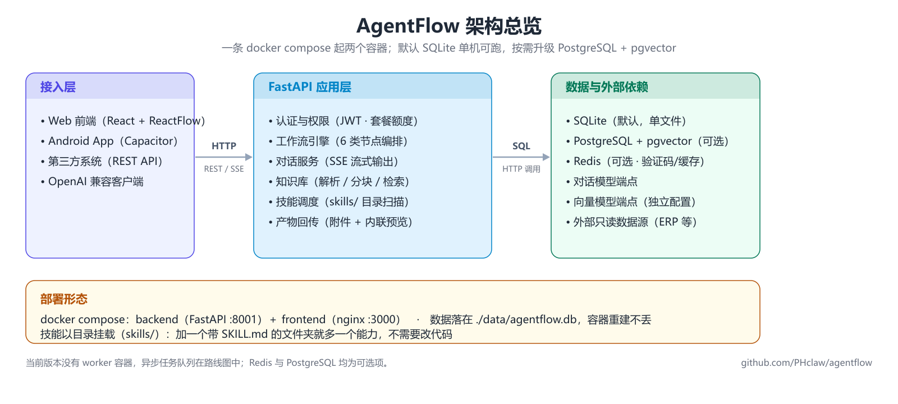

# 发布稿（第一周全平台通用底稿）

> 用法：正文不用改，按平台换标题和开头 100 字（见文末「平台适配」）。
> 配图建议：从 `assets/gifs/` 里取 1 段主 GIF + 2 张截图，不要超过 3 张，手机端会被淹没。

---

## 标题备选（按平台挑一个）

| 平台 | 标题 |
|:--|:--|
| V2EX | 一个人做了一个能装进自己机房的 AI Agent 平台，还带安卓 App |
| 掘金 / CSDN | 我把 Dify 换成了一台 2C4G 云主机就能跑的自托管 Agent 平台 |
| 知乎 | 中小企业想私有化部署 AI Agent，除了 Dify 还有什么选择？ |
| 公众号 | 5 分钟搭一个能干活的 AI 助手，数据不出内网 |

---

## 正文

### 先说结论

我做了个开源项目 **AgentFlow**：拖几个节点、填几行提示词，就能把「大模型 + 企业文档 + 工具箱」拼成一个能干活的 AI 助手。一条 `docker compose up -d` 起在自己的服务器上，数据不出内网。

它不是什么新概念，市面上有 Dify、Coze。我做它，是因为在几个真实项目里反复遇到同四个问题：

1. 客户不让数据出门，SaaS 方案第一轮就被否；
2. 平台只支持自家模型，换个模型要重搭；
3. 聊天机器人能答不能交付，最后还是人手工整理成表、成稿；
4. 定制一个场景动辄几周，验证一个想法成本太高。

### 它长什么样

（此处放 30 秒全流程 GIF：落地页 → 选模板 → 建 Agent → 对话 → 出结果）

界面就这么几块：落地页、控制台、Agent 配置、工作流画布、对话页、知识库、Skill 广场、模板市场。

### 三个我认为值得说的点

**一、默认 SQLite，单机就能跑**

大多数同类项目要求 PostgreSQL + Redis + worker 四五个容器起步。AgentFlow 默认只有一个 SQLite 文件，`docker compose up -d` 起来就是两个容器（后端 + nginx），数据落在 `./data/agentflow.db`，`down` 掉也不会丢，复制文件就是备份。

真的需要扛量了，再加 `--profile postgres` 切到 PostgreSQL + pgvector，代码不用改。

**二、模型可以随时换，不用重启**

在「设置 → 模型配置」里填三样：端点、模型名、Key。只要是 OpenAI 兼容协议就行——OpenAI、DeepSeek、通义、Moonshot，或者本地跑的 Ollama。改完立刻生效，方便同一个场景下横向比效果。

对话模型和向量模型是分开配的，换对话模型不影响已经入库的向量。

**三、它真的会交付文件**

这是我自己最在意的部分。Skill 广场开箱带 26 个技能目录，常用的有这么几个：

- 贴一张乱七八糟的表格 → 出图表（原始数据和脚本一起给你）
- 说一句「做个 10 页的产品介绍 PPT」→ 生成 16:9 的 HTML 简报
- 上传 PDF → 提目录、提要点、提表格，或者直接对着文档提问

产物不是一段文字，是真实的 xlsx / png / pdf 文件，作为附件回传；图片类直接内联渲染在对话里，不用先下载再看。

（此处放「贴表格出图」GIF）

### 技术架构（给想深挖的人）



三层，没有隐藏组件：接入层（Web / 安卓 / API）、FastAPI 应用层（认证、工作流引擎、对话、知识库、技能调度）、数据与外部依赖（SQLite 默认，PostgreSQL + pgvector 可选）。

前端 React 18 + ReactFlow，后端 Python 3.11 + FastAPI + SQLAlchemy 2.0（async），向量检索走独立配置的 embedding 端点。没有引入 Celery、没有 worker 容器——单机场景下用不上，也就不该出现在默认部署里。

### 30 秒跑起来

```bash
git clone https://github.com/PHclaw/agentflow.git
cd agentflow
cp .env.example .env      # 至少填 JWT_SECRET_KEY
docker compose up -d --build
```

打开 `http://localhost:3000` 就是完整界面。也可以先不装，直接试在线演示。

### 顺手做的一件事：安卓 App

项目前端是 React SPA，我顺手用 Capacitor 打了一个安卓包，现在在 GitHub Releases 里能直接下。

同类开源 Agent 平台里带移动端的很少，这件事本身花的时间不到一天——如果你也有 Web 版想变成 App，可以看看仓库里 `frontend/capacitor.config.ts` 的配置方式。

### 现在有什么，缺什么

**已经能用的**：拖拽工作流（6 类节点）、多模型热切换、知识库 RAG、26 个内置技能、模板市场、产物附件回传、用户体系、Docker 一键部署、移动端 App。

**还在做的**：pgvector 路径的端到端验证、异步任务队列（当前没有 worker 容器）、更多技能与模板。

**已知的坑我写在 README 里了**，比如 Docker 部署必须填 `EMBEDDING_BASE_URL`，否则镜像里没有向量模型会静默失败。

### 最后

项目是 GPL-2.0，代码、文档、演示素材（连录屏脚本）都在仓库里。

如果你正好有「想让 AI 干点活，但数据不能出门」的场景，欢迎试试，也欢迎直接提需求——我这边的优先级基本由真实反馈决定。

- 仓库：https://github.com/PHclaw/agentflow
- 在线体验：http://159.75.21.251:3000
- 安卓包：https://github.com/PHclaw/agentflow/releases

如果觉得有点用，给个 ⭐ 就是最大的支持。

---

## 平台适配

| 平台 | 开头怎么改 | 注意 |
|:--|:--|:--|
| **V2EX（分享创造）** | 开头直接说「个人项目，一个人做的，欢迎拍砖」 | 不要带任何营销腔，标题别用「最强」；被问技术细节要当天回 |
| **掘金** | 开头换成「线上部署时踩了 3 个坑，最后自己造了个轮子」 | 分类选「后端 / AI」，标签带 Docker、FastAPI |
| **CSDN** | 开头加一段「适用人群」清单 | 文章要带步骤截图，读者偏实操 |
| **知乎** | 开头用提问式：私有化部署到底难在哪 | 结尾不要硬广，放「项目地址」一行即可 |
| **公众号** | 开头讲故事：一个客户的三次拒绝 | 图文并排，GIF 转视频更稳 |
| **小红书 / 抖音** | 不要正文，只要 15 秒视频 + 一句话 | 用「贴表格 30 秒出图」这段最抓人 |

## 配图清单

| 用途 | 文件 |
|:--|:--|
| 首图 / 全流程 | `assets/gifs/demo-product-tour.gif` |
| 出图演示 | `assets/gifs/demo-skill-plaza.gif` |
| 出 PPT 演示 | `assets/gifs/demo-ppt-generation.gif` |
| 工作流画布 | `assets/screens/05-workflow.png` |
| 知识库检索 | `assets/gifs/demo-knowledge-rag.gif` |
| 架构图 | `assets/diagram/architecture.png`（源文件 .svg 可改色） |
| 移动端 | 手机截图（需现拍一张） |
