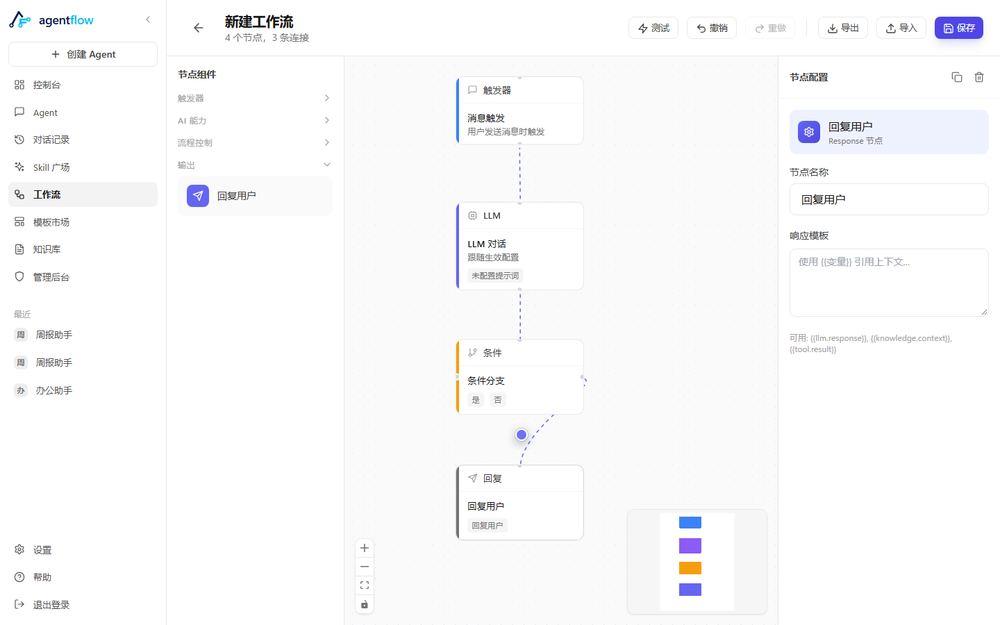

# AgentFlow Wiki

> 零代码 AI Agent 平台：拖几个节点、填几行提示词，把「大模型 + 你的文档 + 工具箱」拼成一个能干活的助手。
> 一条 `docker compose up -d` 跑在自己的服务器上，数据不出内网。

---

## 这是什么

AgentFlow 是一个可以完全自托管的 AI Agent 平台。前端 React + ReactFlow 画布，后端 FastAPI，默认 SQLite 单文件存储——不装 PostgreSQL、不装 Redis 也能完整运行。



## 能做什么

| 能力 | 说明 |
|:--|:--|
| **拖拽式工作流** | 触发器 / LLM / 知识库 / 工具 / 条件分支 / 回复 六类节点自由组合，改完即生效 |
| **多模型热切换** | 任意 OpenAI 兼容端点（OpenAI / DeepSeek / 通义 / Ollama），界面改完不用重启 |
| **知识库 RAG** | 上传文档自动分块入库，检索结果带相关度；向量模型与对话模型分开配置 |
| **26 个内置技能** | Excel / PPT / PDF / 学术检索 / 会议纪要 / 统计分析等，加一个 `SKILL.md` 目录即可扩展 |
| **产物交付** | 生成的文件作为附件回传，图片类直接内联渲染在对话里 |
| **模板市场** | 客服 / 销售 / HR / 财务场景一键套用成 Agent |
| **安卓端** | Release 里有正式签名 APK |

---

## 三分钟上手

```bash
git clone https://github.com/PHclaw/agentflow.git
cd agentflow
cp .env.example .env      # 至少填 JWT_SECRET_KEY
docker compose up -d --build
```

打开 `http://localhost:3000`，注册账号后进「设置 → 模型配置」填上模型端点即可开始对话。

详细步骤见 [[快速开始]]。

---

## 导航

- [[快速开始]] —— 部署方式、首次配置、验证清单
- [[模型配置]] —— 接新模型、Ollama、向量模型
- [[常见问题]] —— 起不来、检索不准、收不到验证码
- [[架构说明]] —— 分层、工作流节点、关键取舍

仓库内还有更完整的文档：`docs/CONFIGURATION.md`（配置）、`docs/ARCHITECTURE.md`（架构）、`docs/DEPLOYMENT.md`（部署）、`docs/API.md`（接口）、`docs/FAQ.md`（FAQ）。

---

## 顺手一提

- 在线演示：http://159.75.21.251:3000 （需要邮箱注册收验证码；站点是 http，浏览器提示不安全属正常）
- 反馈：Bug 走 [Issues](https://github.com/PHclaw/agentflow/issues)，使用问题走 [Discussions](https://github.com/PHclaw/agentflow/discussions)
